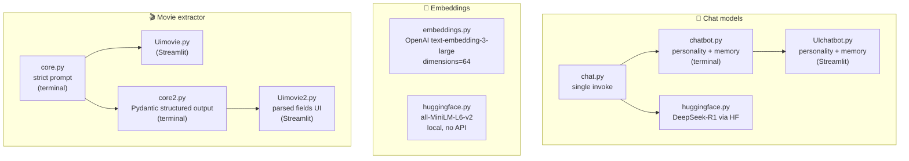

# 🤖 Gen-AI — LangChain Learning Lab

My hands-on tour of generative AI building blocks: chat models, embeddings, and a structured information extractor — each file is one concept, built and run.

## ✨ What's inside

Three tracks, one repo:

**💬 Chat models** (`chatmodels/`)
- `chat.py` — first steps: a single model call (Gemini 3.7 Flash) with temperature and token controls
- `chatbot.py` — terminal chatbot with **personalities** (sad / funny / angry) via `SystemMessage` and full conversation memory
- `UIchatbot.py` — the same chatbot as a Streamlit app (session state, chat UI, cached model)
- `huggingface.py` — open-source models via HuggingFace: DeepSeek-R1 through `HuggingFaceEndpoint`

**🔢 Embeddings** (`embeddingmodels/`)
- `embeddings.py` — OpenAI `text-embedding-3-large` with reduced `dimensions=64` for cheaper storage
- `huggingface.py` — local embeddings with `sentence-transformers/all-MiniLM-L6-v2` (no API needed)

**🎬 Movie extractor** (`company/`)
- `core.py` / `Uimovie.py` — paste a movie paragraph, get back title, genre, year, director, cast, plot, themes… with a strict *"use only what's written, never invent"* system prompt (terminal + Streamlit UI)
- `core2.py` / `Uimovie2.py` — the same extractor upgraded to **structured output**: a Pydantic `MovieInfo` schema parsed by `PydanticOutputParser`, with graceful fallback to raw text when parsing fails

## 🏗️ Architecture



## 📁 Project Structure

```
├── chatmodels/
│   ├── chat.py          # first model call: Gemini 3.7 Flash, temperature/tokens
│   ├── chatbot.py       # terminal chatbot: sad/funny/angry personalities + memory
│   ├── UIchatbot.py     # Streamlit version of the personality chatbot
│   └── huggingface.py   # DeepSeek-R1 via HuggingFaceEndpoint
├── embeddingmodels/
│   ├── embeddings.py    # OpenAI text-embedding-3-large, dimensions=64
│   └── huggingface.py   # local sentence-transformers embeddings
├── company/
│   ├── core.py          # movie extraction, strict anti-hallucination prompt (terminal)
│   ├── Uimovie.py       # movie extraction (Streamlit UI)
│   ├── core2.py         # movie extraction with Pydantic structured output (terminal)
│   └── Uimovie2.py      # structured movie extraction (Streamlit UI)
└── requirements.txt
```

## 🚀 Quickstart

```bash
pip install -r requirements.txt
```

Create a `.env` file (never commit this):

```
GOOGLE_API_KEY=your-key-here
OPENAI_API_KEY=your-key-here
HUGGINGFACEHUB_API_TOKEN=your-token-here
```

Run anything:

```bash
python chatmodels/chatbot.py      # personality chatbot in the terminal
streamlit run chatmodels/UIchatbot.py   # personality chatbot in the browser
python company/core2.py           # structured movie extraction in the terminal
streamlit run company/Uimovie2.py # structured movie extraction in the browser
```

## 🧠 Design Decisions

| Choice | Why |
|---|---|
| **Personality via `SystemMessage`** | One system message ("you are a sad AI agent…") steers the whole conversation — no fine-tuning needed for style. |
| **Memory = message history** | Appending `HumanMessage`/`AIMessage` to a list (or Streamlit session state) is the simplest conversation memory there is. |
| **Strict extraction prompt first, schema second** | `core.py` constrains the model with words (*"do not make up information"*); `core2.py` constrains it with a Pydantic schema. Two different philosophies for reliable extraction — worth comparing. |
| **Graceful parse fallback** | If the model's output doesn't fit the schema, `Uimovie2.py` shows the raw text instead of crashing — structured output is a request, not a guarantee. |
| **`dimensions=64` on OpenAI embeddings** | Truncated embeddings keep 64 dimensions instead of 3072 — far cheaper to store/search, still useful for similarity. |
| **Local embeddings option** | `all-MiniLM-L6-v2` runs on your machine: zero API cost, works offline — the trade-off is quality vs. the big OpenAI model. |
| **`@st.cache_resource` for models** | Model clients are created once and reused across reruns instead of reconnecting every click. |

## 🛠️ Tech Stack

Python · LangChain · Google Gemini (3.7 Flash, 2.5 Flash, 3.5 Flash-Lite) · OpenAI · HuggingFace (DeepSeek-R1, sentence-transformers) · Streamlit · Pydantic · Python-dotenv

## 🎓 What I learned

- Chat models are just `model.invoke(messages)` — personality is a system message, memory is a list.
- The same code runs on Gemini, OpenAI, or HuggingFace endpoints — LangChain's chat interface makes models interchangeable.
- Embeddings turn text into vectors; smaller dimensions = cheaper, local models = free and offline.
- For extraction you have two levers: strict prompting ("don't invent") and schemas (`PydanticOutputParser`) — and you still need a fallback when the model disobeys.
